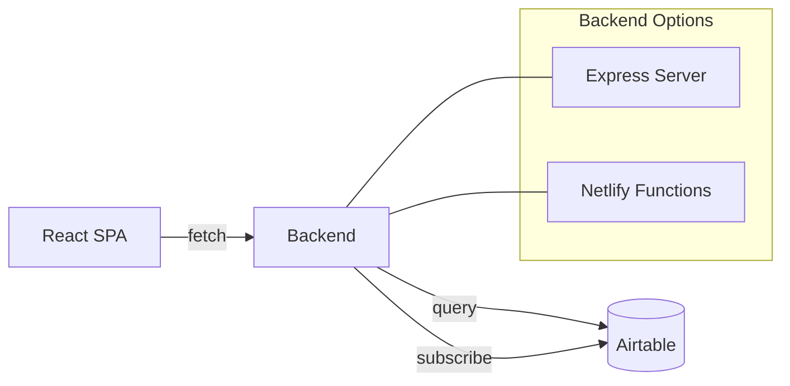

# Architecture

IndieFast follows a standard React SPA architecture with multiple backend options for flexibility.

## System overview

## Frontend architecture

The React application is organized around a single-page tool directory:

| Component | File | Purpose |
|-----------|------|---------|
| App | `src/App.tsx` | Root component, state management |
| Header | `src/components/Header.tsx` | Site branding |
| FilterBar | `src/components/FilterBar.tsx` | Category and subtopic filters |
| ToolGrid | `src/components/ToolGrid.tsx` | Grid layout for tool cards |
| ToolCard | `src/components/ToolCard.tsx` | Individual tool display |
| SpeedStack | `src/components/SpeedStack.tsx` | User's selected tools panel |
| Newsletter | `src/components/Newsletter.tsx` | Email capture form |

## Backend options

IndieFast supports two backend configurations:

1. **Express server** (`server.js`): Local development with rate limiting and caching
2. **Netlify Functions** (`netlify/functions/`): Serverless deployment on Netlify

Both backends connect to Airtable for tool data and subscriber storage.

## Data flow

1. Frontend calls `/api/tools`
2. Backend checks cache (1-minute TTL)
3. If cache miss, fetches from Airtable "Tools" table
4. Returns JSON array of tools
5. Frontend caches in sessionStorage (5-minute TTL)
6. Falls back to mock data if API unavailable

## Caching strategy

- **Server-side**: 60-second cache with 30-second error backoff
- **Client-side**: sessionStorage with 5-minute TTL
- **Graceful degradation**: Mock data when Airtable unavailable
