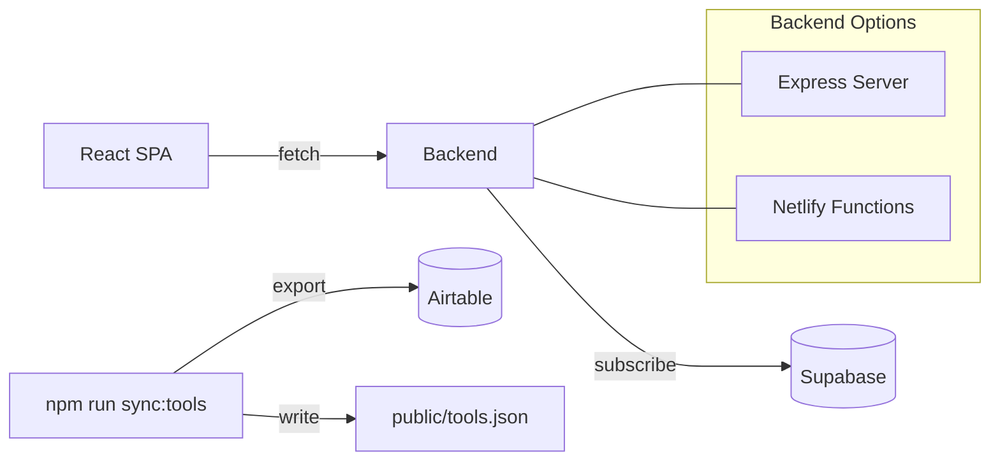

# Architecture

IndieFast follows a standard React SPA architecture with multiple backend options for flexibility.

## System overview

## Frontend architecture

The React application is organized around a single-page tool directory:

| Component | File | Purpose |
|-----------|------|---------|
| App | `src/App.tsx` | Root component, state management |
| Header | `src/components/Header.tsx` | Site branding |
| FilterBar | `src/components/FilterBar.tsx` | Category and subtopic filters |
| ToolGrid | `src/components/ToolGrid.tsx` | Grid layout for tool cards |
| ToolCard | `src/components/ToolCard.tsx` | Individual tool display |
| SpeedStack | `src/components/SpeedStack.tsx` | User's selected tools panel |
| Newsletter | `src/components/Newsletter.tsx` | Email capture form |

## Backend options

IndieFast supports two backend configurations:

1. **Express server** (`server.js`): Local development with rate limiting and caching
2. **Netlify Functions** (`netlify/functions/`): Serverless deployment on Netlify

Subscribe endpoints write to Supabase `subscribers`. Tool data is served from the committed `public/tools.json` snapshot (refreshed via Airtable with `npm run sync:tools`).

## Data flow

1. Frontend loads tools from the bundled/snapshot `tools.json` (prod) or public snapshot (dev)
2. Newsletter form posts to `/api/subscribe`
3. Backend validates email and inserts into Supabase `subscribers` (or mocks if env missing)
5. Frontend caches in sessionStorage (5-minute TTL)
6. Falls back to mock data if API unavailable

## Caching strategy

- **Server-side**: 60-second cache with 30-second error backoff
- **Client-side**: sessionStorage with 5-minute TTL
- **Graceful degradation**: Mock data when Airtable unavailable
